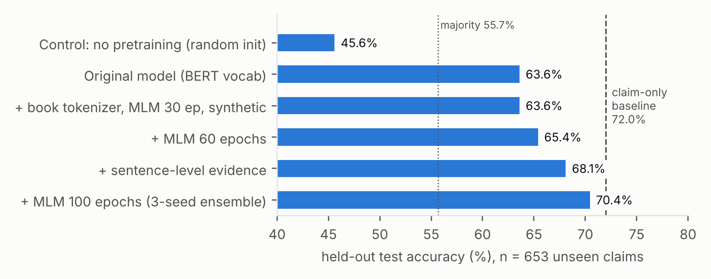
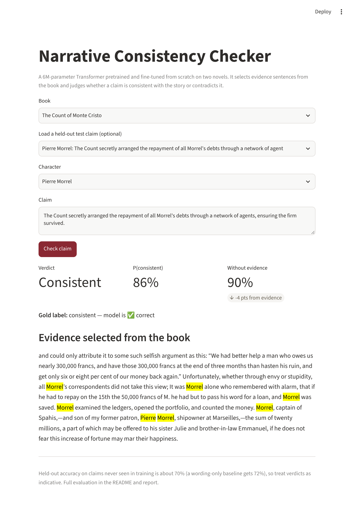

# Retrieval-Augmented Narrative Consistency Verification

Given a claim about a character in a novel — *"Villefort: He attributed both deaths to grief; it never occurred to him that poison was involved"* — decide whether it is **consistent** with the book or **contradicts** it.

The classifier is a BERT-style Transformer **built entirely from scratch in PyTorch**: its tokenizer is learned from the novels, its encoder is pretrained by masked language modelling on the novels, and it is then fine-tuned on the labelled claims. Evidence comes from a **hybrid BM25 + dense retrieval** pipeline with sentence-level evidence selection.

**Results in one line:** on unseen claims, the original model scored 63.6% and the final 3-seed ensemble scores **70.4%** (F1 0.703, AUC 0.768). It is statistically on par with a strong claim-only baseline (72.0%). Pretraining on the books is worth about **+20 points**. The originally reported 97.56% was **data leakage**.

📄 **Technical report:** [`report/report.pdf`](report/report.pdf) · 🖥️ **Demo:** `streamlit run app.py`

Course project — Advanced NLP, M.Tech IT, ABV-IIITM Gwalior.

---

## How it works

```
                 ┌── 1. book_tokenizer.py ── WordPiece vocabulary (8k) learned from the novels
  novels ────────┤
                 └── 2. pretrain_mlm.py ──── masked-LM pretraining of the encoder (100 epochs)
                                                     │ encoder.pt
                                                     ▼
"char: claim" ─► Retriever ─► top-8 passages ─► evidence.py: best sentences ─► [CLS] evidence [SEP] char: claim [SEP] ─► encoder ─► consistent / contradict
                    │                           packed into 256 tokens                                                 ▲
                    ├── BM25 (keyword)    ─┐                                              3. fine-tune on labelled claims
                    └── MiniLM (semantic) ─┴── 0.6·semantic + 0.4·BM25                        + synthetic pairs (synth_data.py)
```

| Stage | What | Why |
|---|---|---|
| Tokenizer | WordPiece, 8,000 tokens, trained on the six book files in `Dataset/Books` (`book_tokenizer.py`) | BERT's borrowed 30k vocabulary made the embedding table 7.8M of the old model's 10.8M parameters. The book vocabulary keeps names like *Villefort* whole. |
| Pretraining | BERT-style masked LM on 938k book tokens: 15% masking (80/10/10), two-segment windows, tied decoder, 100 epochs (`pretrain_mlm.py`) | 1,669 distinct claims are far too few to teach a random Transformer what words mean. The books are free unlabelled text. |
| Character-aware query | The `char` column is prefixed to the claim and the retrieval query | 66% of claims start with "He" or "She". |
| Sentence-level evidence | Split the top 8 passages into sentences, score each against the claim (+ bonus if it names the character), and pack the best into the 256-token budget (`evidence.py`) | **Bug fix:** three 200-word passages are about 840 tokens, so truncation had left the model only the first quarter of one passage. |
| Synthetic pairs | 2,400 examples mined from the books (`synth_data.py`). *Consistent* is a book sentence lightly paraphrased. *Contradict* is the same sentence with one fact changed: two characters' roles swapped, a name, a number, or a negation. | Real claims can be classified from wording alone. In these pairs both labels share their wording, so only the evidence separates them. |
| Fine-tuning | Group-balanced sampling (one copy per claim per epoch), label smoothing 0.1, early stopping on val macro-F1, 3 seeds averaged | The CSV holds up to 10 near-copies of each claim, and single runs vary by ±3 points. |

**Model:** pre-LayerNorm encoder, 4 layers × 4 heads, d = 256, FFN 1024, **6.06M parameters**, all trained from random initialisation. The only pretrained component in the project is the MiniLM sentence encoder used for retrieval.

---

## Results

### 1. The original 97.56% was leakage

The CSV's 4,569 rows contain only **1,669 distinct claims**; the rest are copies with filler (*"Moreover, …"*). Under the original random split, about 75% of validation rows had a near-copy in training, and a claim-only TF-IDF model that never reads the book scored **94.75%**. `splits.py` now groups each claim with its copies and splits by group: **train 3,263 rows / val 653 / held-out test 653 (238 unseen claim groups)**.

### 2. Held-out test (unseen claims)

| Model | Accuracy | Macro F1 | ROC-AUC | Accuracy without evidence |
|---|---|---|---|---|
| Majority class | 55.7% | — | 0.500 | — |
| **Claim-only TF-IDF baseline** (never reads the book) | **72.0%** | 0.716 | 0.817 | — |
| Original model (BERT vocab, no pretraining, 10.8M) | 63.6% | 0.590 | 0.669 | — |
| Control: no pretraining (random init) | 45.6% | 0.354 | 0.568 | 55.7% |
| Book tokenizer + MLM 30 ep + char prefix | 62.3% | 0.616 | 0.632 | 64.3% |
|  + synthetic pairs | 63.6% | 0.625 | 0.656 | 53.9% |
|  + MLM 60 epochs | 65.4% | 0.649 | 0.694 | 66.6% |
|  + sentence-level evidence | 68.1% | 0.681 | 0.725 | 68.9% |
|  + MLM 100 epochs, single seeds (mean ± sd) | 69.8 ± 3.1% | 0.697 | 0.747 ± 0.038 | 65.5 ± 3.5% |
| **+ MLM 100 epochs, 3-seed ensemble (final)** | **70.4%** | **0.703** | **0.768** | 68.6% |

<p align="center"></p>

**Findings**
- **Pretraining is decisive.** The same model trained from random weights never leaves the majority-class plateau (45.6%). Pretrained on the novels it reaches 65.4%, about +20 points. Longer pretraining kept helping, and the MLM loss had not converged at 100 epochs (held-out perplexity 249 → 128 → 98).
- **On par with the baseline, not above it.** The ensemble trails by 1.6 points. The 95% cluster-bootstrap CI for the difference is [−8.0, +4.8], so the two are not statistically distinguishable.
- **Evidence helps ranking more than accuracy.** Removing evidence drops ensemble AUC from 0.768 to 0.721, but the +1.8-point accuracy effect is not significant (CI [−3.6, +7.2]). The synthetic pairs are what make the model use the evidence at all: without them, blanking the evidence did not hurt.
- **Variance matters.** Seeds differ by up to 6 points, and two recipes with the same validation F1 differed by 9 points on test. That's why the final result is a seed mean plus an ensemble. Doubling the synthetic data hurt (59.1%).

Every number is in `exp_results.jsonl` (all runs), `final_eval.json` (seeds, ensemble, bootstrap) and `results.json` (`main.py` output for the single selected model).

### Limitations
1. **Dataset artifacts.** The wording of a claim gives away its label for 72% of unseen claims, which limits what this data can show about evidence use.
2. **Test reuse.** Choices were made on validation, but test scores were viewed after every run, so the final numbers may be mildly optimistic.
3. **Evidence recall.** Claims summarise whole storylines, but the model reads about 240 tokens of evidence.
4. **Two novels, one genre.** `Dataset/test.csv` (60 rows) is unlabelled.

### Demo

`streamlit run app.py`: pick a character, type a claim (or load a real held-out test claim with its gold label), and see the verdict, the evidence the model read, and how much the evidence moved the prediction.

<p align="center"></p>

---

## Running it

```bash
python -m venv venv && source venv/bin/activate
pip install -r requirements.txt

python baseline.py                 # claim-only baselines + leakage check (seconds)
python book_tokenizer.py           # 1. WordPiece vocabulary from the novels (~10 s)
python pretrain_mlm.py --epochs 100            # 2. MLM pretraining (~3.3 min/epoch on 2 CPU cores)
python pretrain_mlm.py --epochs 100 --resume   #    continue after an interruption
python synth_data.py --n 2400 --out cache/synth_samples_final.pkl   # 3. synthetic pairs
python main.py                     # 4. retrieval, grouped split, fine-tune, held-out test, plots, results.json
python main.py --skip-training     # re-evaluate the saved model
python inference.py                # predictions for Dataset/test.csv
streamlit run app.py               # interactive demo (uses the 3-seed ensemble in models_ensemble/)
```

The switches in `config.py` (`PRETRAINED`, `USE_SYNTH`, `WITH_CHAR`, `SENTENCE_EVIDENCE`, `GROUP_SAMPLING`) each turn one improvement on or off, so every row of the table can be reproduced. On a GPU or Apple MPS everything runs in minutes. On 2 CPU cores, pretraining takes about 5.5 h and fine-tuning about 1 h per seed.

Shipped: the retrieval index `cache/embedding_index/` (so retrieval reproduces exactly), `model_pretrained/encoder.pt` (MLM encoder), `model/` (seed 42, selected on validation, used by `main.py`), `models_ensemble/seed_{42,7,123}/` (used by `verify.py` and `app.py`).

---

## Layout

```
├── main.py                 # end-to-end pipeline
├── config.py               # paths, hyperparameters, feature switches
├── book_tokenizer.py       # WordPiece vocabulary trained on the novels
├── pretrain_mlm.py         # masked-LM pretraining of the encoder
├── evidence.py             # sentence-level evidence selection
├── synth_data.py           # self-supervised contradiction pairs from the books
├── verify.py               # check one claim end to end (ensemble)
├── app.py                  # Streamlit demo
├── data_loader.py, chunking.py, embedding.py, retrieval.py
├── splits.py               # leakage-free grouped train/val/test split
├── baseline.py             # claim-only baselines (artifact check)
├── dataset_builder.py      # claim → evidence input construction
├── custom_nli_model.py     # from-scratch Transformer, MLM head, encoder loading
├── train_scratch.py        # fine-tuning loop, group-balanced sampling, checkpointing
├── metrics.py, run_metrics.py, evaluate_plots.py, inference.py
├── report/                 # report.pdf, figures, make_figures.py
├── Dataset/                # Books/ (public domain) + combined_train_v2.csv
└── legacy/                 # earlier scripts and notes from the original version, not used by the pipeline
```

## Next steps
- **Minimal-pair test set:** single-edit contradictions of consistent claims, which remove the wording shortcut and measure evidence use directly.
- **Character dossiers:** retrieve from every passage that names the character, or use a longer-context encoder.
- **Longer pretraining**, plus a cross-attention (ESIM-style) comparison between claim and evidence.
